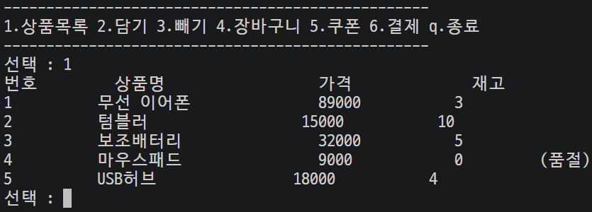
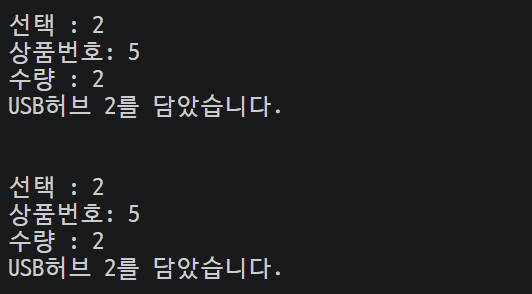
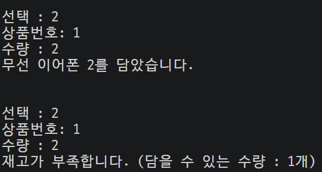
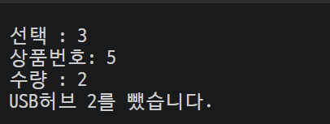
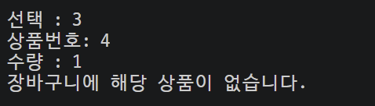
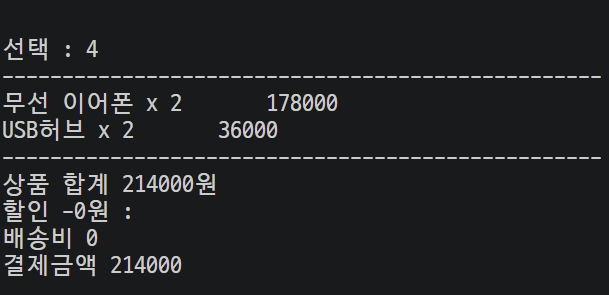
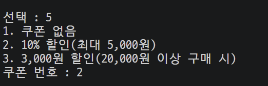
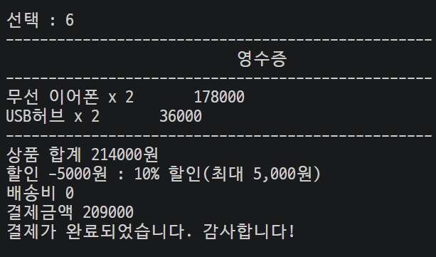
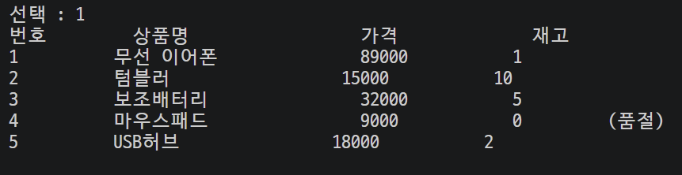

# Mini Project 02 : 온라인 쇼핑몰 장바구니 만들기

 

## 1. 프로젝트 개요
- 기능별 함수, 클래스와 메서드를 활용하여 온라인 쇼핑몰 장바구니를 제작

 

## 2. 주요 기능

### 1️⃣ 쇼핑몰 상품목록 보여주기

- 초기화면 메뉴 선택에 1 입력 시, items_list, items_list_print 함수를 통해 상품목록 출력, 상품 번호는 클래스 변수(item_number)를 이용하여 자동 카운트

  - items_list 함수 : Item 클래스를 통해 상품명, 가격, 재고 속성을 포함한 인스턴스들을 생성하고 이를 items_list에 추가, 상품목록을 반환

  - items_list_print 함수 : 상품 객체들을 포함한 items_list를 바탕으로 상품 항목들을 보기 좋은 목록 형태로 출력

**[실행 화면]**  

---

### 2️⃣/3️⃣ 장바구니에 상품 담기/빼기

- main 함수 실행 전, Shoppingcart 클래스 생성자로 쇼핑카트 리스트를 생성, main 함수 이전에 최초 1회 생성 후 products_list에 해당 쇼핑카트 리스트를 저장하여 계속 활용

- 초기화면 메뉴 선택 2 입력 시 Shoppingcart 클래스의 쇼핑카트 담기(in_cart), 3 입력시 빼기(out_cart) 메서드를 실행함

- 각 메서드는 상품 번호와 수량을 인수로 받아 해당 번호의 상품을 주어진 수량만큼 장바구니에 넣거나 뺌

  - in_cart 메서드: 처음 상품을 넣는 경우, 상품 객체를 쇼핑카트 리스트 안에 저장하고 기존에 있는 상품을 다시 넣는 경우, 수량만 추가(case1)
    - 단, 재고 이상으로 장바구니에 상품을 추가하려는 경우(case2), 처리하지 않음

**[실행 화면]**  
(case 1) 재고 내에서 장바구니에 같은 상품을 추가하는 경우 -> 정상 처리  

(case 2) 재고 이상으로 장바구니에 상품을 추가하려는 경우 -> 미처리  

  - out_cart 메서드: 카트에 있는 상품을 일부만 빼는 경우, 수량만 제함(case 3)
    - 단, 수량이 0 이하가 되는 경우 객체 자체를 카트에서 삭제
    - 카트에 없는 상품을 빼려고 하는 경우, 처리하지 않음(case 4)

**[실행 화면]**  
(case 3) 담겨있는 상품 4개 중 2개만 빼는 경우 -> 정상 처리  

(case 4) 담겨있지 않은 상품을 빼려고 하는 경우 -> 미처리  

---

### 4️⃣ 장바구니 상태 보여주기

- 초기화면 메뉴 선택 4 입력 시, shoppingcart_show 함수가 실행되며 현재 장바구니 상태를 보여줌

- 장바구니 내 상품 및 개수 목록, 상품별 합계, 금액 총 합계, 할인쿠폰 선택/적용, 배송비, 결제 금액 등을 표시
  - 총 합계가 3만원을 넘거나 카트가 비어있는 경우 배송비는 0원, 이외는 3000원
  - 결제 금액은 할인쿠폰 적용 금액과 배송비까지 계산한 금액

**[실행 화면]**  

---

### 5️⃣ 쿠폰 선택하기

- 초기화면 메뉴 선택 5 입력 시, coupon_select 함수를 통해 사용자에게 쿠폰 목록을 보여주고, 입력받은 쿠폰 번호, 쿠폰 이름(할인 내용)을 저장

- 장바구니 상태 출력시 coupon 함수와 Discount(부모 클래스), RateDiscount(자식 클래스1), FixedDiscount(자식 클래스2)가 실행되며 쿠폰 선택에 따른 할인액을 계산

**[실행 화면]**  

---

### 6️⃣ 결제하기

- 초기화면 메뉴 선택 6 입력 시, 영수증(쇼핑카트 목록 활용)과 결제 성공 멘트 등을 출력, 상품 재고 변경 / 카트 초기화 / 쿠폰 정보 초기화 진행
  - 단, 결제할 상품이 없는 경우, 처리하지 않음

**[실행화면]**  
(case 1) 장바구니 상품 정상 결제 및 재고 차감

(case 2) 장바구니 초기화 등으로 결제할 것이 없는 경우 -> 미처리  

 

## 3. 보완해야할 점

### (1) 개념 보충 필요
- while문 개념(while 안의 if 안에 break를 적어도 while문 탈출하는 점 등)
- 클래스 인스턴스 속성, 메서드 활용법
- str, repr로 인스턴스 전체를 출력 vs 인스턴스 속성을 명시하여 한 요소만 출력
- 클래스 상속을 언제 어떤 식으로 쓰는 것이 효율적인지 예시 더 많이 확인 필요
- 빈 값 == False 가 아니라는 점(not으로 판단)

### (2) 코드
- 프로그램(main 함수) 실행 전 미리 변수에 저장해 놓아야하는 값들에 대한 판단
- 코드 간소화, 반복을 줄이기 위한 적절한 기능 함수 사용 등
- 다양한 예외 경우를 미리 파악, 오류를 방지하기 위한 사전예방적 코딩
- 변수 선언 위치 틀림, 비슷한 의미의 다른 변수 사용 등으로 NameError 자주 발생
- 기능별로 함수를 묶을 때 가장 효율적인 방식
- 전역 변수, 지역 변수 판단 문제(언제 어떤 변수를 써야 하는가?)
- 장바구니 담기, 빼기 코드에서 for > if > if 로 복잡해지는 코드 최적화 필요
- 객체 속성(cart.shoppinglist)을 활용해야하는데 객체(cart)만 적는 문제
